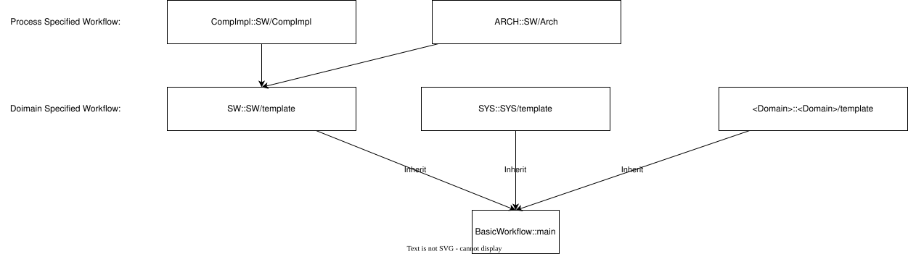

# Basic Workflow

## Major functions and Entries

1. Project will setup the configurations of the gitlab project and also the jobs for each branches for the project. [JenkinsSeed](/workflows/Seeds/JenkinsSeed.workflow.json), [ProjectJenkinsSeed](/workflows/Seeds/ProjectJenkinsSeed.workflow.json)
2. Traceability between git commit and git commit when push to the monitored branches. [PUSH](/workflows/GitlabJenkinsIntegration/PUSH.workflow.json)
3. Plugin suggestions from vscode. [/.vscode/extensions.json](/.vscode/extensions.json)
4. Configure the basic merge request template. [/.gitlab/merge_request_templates](/.gitlab/merge_request_templates)
5. Use the external open tool plugin to open the binary files with 3rd software (e.g. EA, Office). see "openInExternalApp.openMapper" at [/.vscode/settings.json](/.vscode/settings.json)
6. An cylic task will be raised in vscode, to help setup the configuration of the current project local sandbox, to make sure the settings are correct. see project:bootstrap at [/.vscode/tasks.json](/.vscode/tasks.json)
7. When in monitor branches, there is a new commit, workflow will try merge changes to the child branches.[/workflows/Support/MergewithSourceBranch.workflow.json](/workflows/Support/MergewithSourceBranch.workflow.json). 

### Major Entries

#### Gitlab Event Hook

for PUSH, MERGE, TAG event. gitlab will push those events to Jenkins server. For different event activities can be found at [/workflows/GitlabJenkinsIntegration](/workflows/GitlabJenkinsIntegration)

#### Seeds 

The workflow is follow CaC method for configuration and set up. Which means in general every configuration and the script to configure is stored together with the repository. 

Also from the jenkins side, the project is setting up with the script inside repo.

To see how it is set up. refer to 
[JenkinsSeed](/workflows/Seeds/JenkinsSeed.workflow.json), 

[ProjectJenkinsSeed](/workflows/Seeds/ProjectJenkinsSeed.workflow.json)

#### Local Repo Settings

The task will setting up when open with vscode to regularly sync the update of the required local project settings. see project:bootstrap at [/.vscode/tasks.json](/.vscode/tasks.json)

It will setup the Mergedriver etc in the current scope of project.

## Adaptation Needed

NA

## InheritRelationship

The signle route inherit relationship is been used. which means the child project can merge the from its parent or ancestor branches, but never the other way around.

### Way of handling variant:

1. When no dedicated workflow branch exists

    Use the Base Workflow directly.
    Do not create a variant branch prematurely.

2. When a process needs a variant
   
    First create a top-level variant branch (temporary home for process-specific changes).
    Keep changes narrowly scoped to this process/variant.

3. When common requirements emerge across variants
    If multiple variants start sharing the same needs, do not continue piling them on the top-level variant branch.

    Refactor the common part downward:

        - Identify the lowest suitable level that is shared by all impacted variants.

        - Create a Variant Base Branch there (the new common base).

        - Apply the shared changes to this Variant Base Branch.

        - Merge downward from the new base into the affected top-level variant(s).

        - From the Variant Base Branch, branch off any new variants as needed.

4. Merge direction (inheritance rule)

    - Only downward merges are allowed (child ← parent/ancestor).

    - Child/variant branches must include updates from their parent or ancestor branches.

    - No upward merges back into parent/ancestor.

5. Naming recommendations on Branch

    - Basic workflow: main
    - Domain Specified workflow: \<Domain\>/template
    - Undefined Layer workflow: variants/\<VairantName\>
    - Process Specified workflow: \<Domain\>/\<ProcessName\>

## Change Logs

### 0.0.1

- Init setting up
- Use ff method for the MR commit.